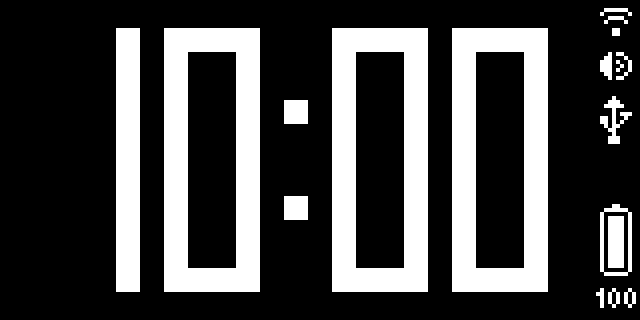
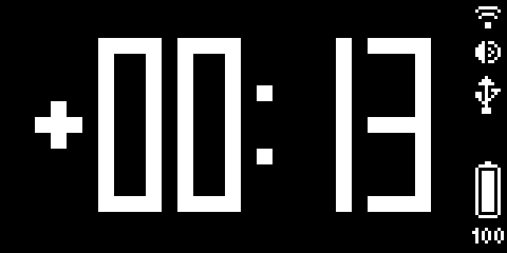

# Talk Timer

A speaker timer with green, yellow and red phases.


A timer for a talk, a lesson or a meeting slot. Set the length with the wheel and press Start: the front display counts the time down in large digits over a band that turns from green to yellow to red as the time runs out, and the back display shows the same time to the audience or to a host behind you.

A JavaScript app for [BUSY Bar](https://busy.app).

## What the bar shows

On start the front display shows the talk length from the settings, 10:00 by default, on a green band. Turning the wheel changes the length a minute at a time, from 1 to 99 minutes.


The back display shows the same time in white digits as large as fit, for the room.



Start starts the countdown. While more time is left than the yellow threshold, the band is green.

With 2 minutes or less left (the yellow setting) the band turns yellow, with a sound and a yellow blink of the status light.


With 1 minute or less left (the red setting) the band turns red, with a sound and a red blink of the status light.


At zero a third sound plays and the light blinks red again, and the timer counts the overtime up on red with a plus sign. The back display shows the overtime too.




Start during the countdown pauses it, and the time stands still until the next Start. A talk that starts already inside the yellow or the red phase does not signal that phase again.

## Buttons

| Button | What it does |
| --- | --- |
| Wheel | Changes the length a minute at a time, before the start. |
| Start | Starts the countdown, pauses it, and goes on after a pause. |
| OK | During a pause, resets the time to the set length. |
| Back | Quits the app. |

## Settings

| Setting | What it does |
| --- | --- |
| Talk length, minutes | The length the app starts with, 1 to 99 minutes, 10 by default. The wheel changes it until the app is closed. |
| Yellow at, minutes left | The band turns yellow when this many minutes are left. 2 by default. |
| Red at, minutes left | The band turns red when this many minutes are left. 1 by default. |
| Sound | The sounds at yellow, at red and at zero. On by default. The status light blinks either way. |

The app reads its settings when it starts.

## Data

None: it works offline and keeps nothing on the BUSY Bar.

## Build

Node 24 and npm:

```sh
npm ci
npm run build         # dist/io.github.vvzvlad.talktimer.tgz
npm run app:install   # install it on a BUSY Bar connected over USB
npm run app:run       # start it
```

## License

[MIT](LICENSE)
